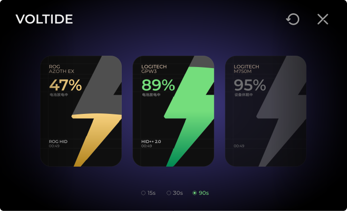
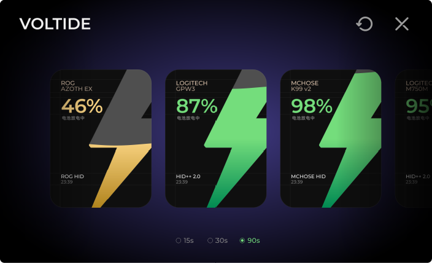
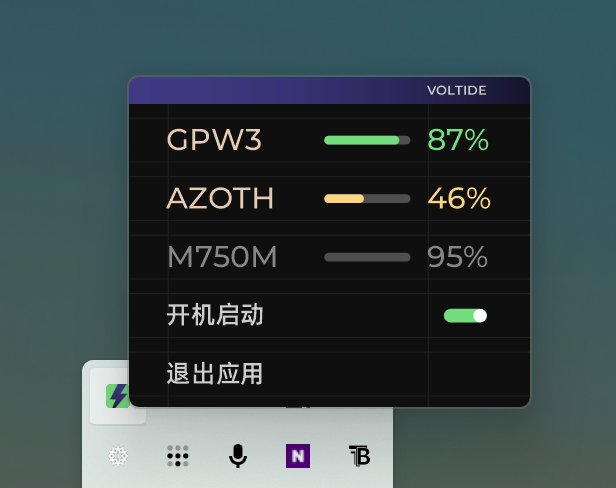

# Voltide

[简体中文](README.md) | **English**


A lightweight Windows tray utility that reports the battery level of 2.4 GHz wireless peripherals — keyboards and mice — in a single panel, without installing any vendor software.

Adapters for Logitech, MCHOSE and ROG ship today. They are the devices the author has access to, not the scope of the tool: the provider layer is designed so that supporting a new brand is one self-contained class.



*Three devices: 89% on battery, 47% mid-level, and one asleep showing its last known level.*



*Four devices. Past three, the row scrolls horizontally with the mouse wheel.*

## Why

Wireless keyboards and mice rarely expose battery level to Windows. Each vendor ships its own utility — G HUB, M HUB, Armoury Crate — and they are heavy, resident processes that must be installed just to read a number.

Voltide queries the devices directly over HID, reads the same values those utilities report, and displays them in one place.

## Features

- **One panel for every device.** Cards are laid out and centred automatically; new devices appear as they connect. Past three devices the row scrolls with the mouse wheel.
- **Liquid level indicator.** The bolt fills according to charge, with a slow wave while the panel is open.
- **Three-tier colour.** Green at 50% and above, amber from 20% to 49%, red below 20%. Both the percentage and the fill follow the tier.
- **Accurate sleep state.** A device that has reported before keeps its last level, dimmed, while asleep — so a sleeping mouse still tells you something.
- **Adjustable polling.** 15 s, 30 s or 90 s while the panel is open. The preference is stored and restored.
- **Tray integration.** The tray icon opens the panel; the context menu lists every device with its current level.
- **Start with Windows.** Optional, toggled from the tray menu.
- **Single file.** 8.8 MB, no installer, no dependencies beyond the .NET Framework that ships with Windows.

## Currently supported

The following devices have been tested against real hardware. They represent what the author owns, not what the architecture is limited to.

| Brand | Model | Protocol |
|---|---|---|
| Logitech | G304, G Pro X Superlight 2 (GPW3), M750M | HID++ 2.0 over LIGHTSPEED / Logi Bolt |
| MCHOSE | K99 v2 | Vendor HID, 20-byte frames |
| ROG | AZOTH EXTREME (夜魔 Extreme) | ROG OMNI RECEIVER, 64-byte frames |

### Adding a device

If your device is not listed, it can be added without touching the interface. Every brand is a self-contained adapter:

```csharp
public interface IDeviceProvider
{
    string Name { get; }
    List<DeviceInfo> Discover();          // enumerate HID collections, match your device
    DeviceReading Read(DeviceInfo device); // send the query, parse the reply
}
```

To add one:

1. Create `src/Providers/YourBrandProvider.cs` implementing `IDeviceProvider`.
2. Register it in `src/Core/DeviceManager.cs` alongside the existing providers.
3. Rebuild.

`Discover()` receives every HID collection the system exposes; `src/Interop/HidNative.cs` provides the enumeration and `HidSession` handles reading and writing. The three existing providers are working examples at increasing complexity; their exact frame layouts are in [Protocol notes](#protocol-notes).

If the vendor's protocol is undocumented, capture it: run the official utility, record the USB traffic with [USBPcap](https://desowin.org/usbpcap/), and locate the request that returns the percentage. That is how all three shipped adapters were written.

**If you add a device, a pull request is welcome.** Please include the model name and the raw reply that carried the battery level, so it can be verified against the source.

## Usage

1. Download `Voltide.exe` from [Releases](../../releases).
2. Run it. The panel opens once; afterwards it lives in the tray.
3. Left-click the tray icon to open the panel, right-click for the device list.

No installation, no background service, no administrator rights required.



*The tray menu lists every device with its current level, alongside the polling interval and start-with-Windows toggle.*

### Reading the panel

| State | Meaning |
|---|---|
| Coloured percentage + filled bolt | Device is awake and reporting |
| Grey percentage, empty bolt | Device is asleep; the value shown is the last reading |
| `--` with 设备休眠中 | Device is idle and has never reported |

### Settings

- **Polling interval** — the three radios at the bottom of the panel (`15s / 30s / 90s`). Defaults to 90 s. Polling slows to 5 minutes while the panel is hidden.
- **Start with Windows** — the switch in the tray menu. Writes a per-user Run entry; no elevation required.

## Requirements

- Windows 10 1903 or later, or Windows 11
- .NET Framework 4.8 (included with the above)

## Build

```powershell
# Compile (uses the C# compiler bundled with Windows)
powershell -ExecutionPolicy Bypass -File build.ps1

# Produce a distributable single file
powershell -ExecutionPolicy Bypass -File pack.ps1 -Target dist
```

The three typefaces are embedded into the executable as manifest resources, so the output is a single file.

## Protocol notes

The vendors never published these. The frame layouts are documented in each provider's header comment.

- **Logitech** — HID++ 2.0. Feature `0x1004`, function 1 returns the percentage; feature `0x1000` is tried as a fallback for older receivers.
- **MCHOSE** — 20-byte frame on report `0x13`. Command `0x4A`, byte 5 carries the percentage, byte 19 is a modulo-256 checksum over the preceding bytes.
- **ROG** — 64-byte frame `02 12 01` written to the receiver's vendor collection (usage page `0xFF00`). Byte 6 of the reply is the percentage; byte 10 is the low-battery threshold configured on the device.

One trap worth recording: Logitech's `0x1004` **function 0** returns voltage, not charge — on an idle device it reports a constant 3.85 V regardless of the real level. Function 1 (`0x1E`) is the one that returns the percentage. Reading function 0 was the original cause of Voltide showing values that disagreed with G HUB.

## Known limitations

- A device that has never reported and is asleep cannot be woken by a query; it will show `--` until it is used.
- The ROG receiver also serves other peripherals. If it is paired with a mouse rather than a keyboard, Voltide will still label it as a keyboard.
- Wireless devices that share a receiver report through that receiver, not individually.

## Licence

MIT. See [LICENSE](LICENSE).

Designed and developed by [Joko](#).
